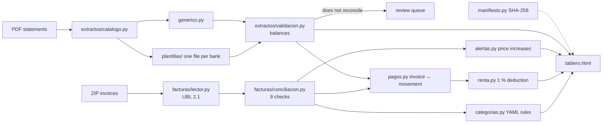

# Factura Viva

[Español](README.md) · **English** · [Portfolio page](https://johangb.github.io/en/projects/factura-viva.html)

  

Turns Colombian **DIAN electronic invoices** (the ZIP files that arrive by email) and **bank
statements** into concrete answers: where the money went, how much really left your accounts,
how much you can deduct in income tax for the 1 % of purchases backed by e-invoices, and which
products went up in price. **Every figure is traceable** back to the raw file, its SHA-256
fingerprint, and the exact line or row it came from.

> Status: **v0.2 — phase 1 (useful MVP without ML)**. Bank templates: AV Villas (credit card),
> Caja Social, Nequi, Nu account and Nu card. Not tax or financial advice.
> Personal data never leaves the local folder: `data/raw`, `data/procesado` and the manifest are git-ignored.

## What it answers today

| Question | How | Evidence |
|---|---|---|
| Were my invoices read correctly? | ZIP → `AttachedDocument` XML → UBL 2.1 invoice; de-duplicated by CUFE | 9 checks per invoice: lines + taxes = total, CUFE, DIAN validation |
| Were my statements read correctly? | One template per bank; generic reader for new banks | Opening balance + movements = closing balance; otherwise sent to a review queue |
| Where did the money go? | Rule-based categories, recording which rule decided | Dashboard with the source table under every chart |
| How much really left my accounts? | Statement outflows minus transfers between my own products | Every movement keeps its PDF page and row |
| How much can I deduct? | 1 % of e-invoiced purchases, capped at 240 UVT (art. 336-5, Tax Code) | Status and reason per invoice; rules in `config/renta.yaml` with source and verification status |
| What got more expensive? | Same product and issuer, current price vs. previous median | Needs two purchases on different dates |

## Run it

```bash
pip install -e ".[dev]"
python ejemplos/demo_sintetico.py   # full demo with synthetic data, opens the dashboard
python -m factura_viva --abrir      # with your own files in data/raw/
pytest -q                           # 93 tests
```

Password-protected PDFs: the password is requested at the prompt, never shown and **never stored**.

## Architecture



Adding a bank = dropping one file in `src/factura_viva/extractos/plantillas/` that defines `LECTOR`.
The catalog discovers it automatically.

## Principles

1. **Traceability** — every row carries source file, SHA-256, line/row and code version.
2. **Immutable raw data** — if a raw file changes, the pipeline stops.
3. **Privacy** — nothing leaves the folder; account numbers are kept as last four digits only.
4. **Better to abstain than to be wrong** — ambiguous matches are not assigned; unseen cases go to review.
5. **Rules as data** — tax rules, categories and tolerances live in versioned YAML.

## Limitations

- Version 0.2, phase 1: a useful MVP without machine learning. Categories come from rules, not a model.
- Price alerts need two purchases of the same product on different dates.
- Templates exist for five bank products only; others go through the generic reader and, if they do not reconcile, to review.
- Not tax or financial advice.

## Roadmap (phase 2+)

- 20–50 labelled invoices to measure per-category F1 and train LightGBM on TF-IDF against the rule baseline.
- Product normalization, association rules and monthly spending forecasts (need more history).
- Export movements to [MyCents](https://github.com/JohanGB/App_HomeFinance).

Docs (Spanish): [decisions](docs/decisiones.md) · [assumptions](docs/supuestos.md) · [AI usage](docs/uso_de_ia.md)

---
Personal portfolio project by **Johan Esteban García Bautista** · MIT License
