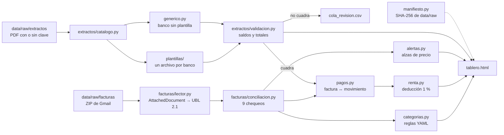

# Factura Viva

**Español** · [English](README.en.md) · [Ficha en el portafolio](https://johangb.github.io/proyectos/factura-viva.html)

  

Convierte las **facturas electrónicas de la DIAN** que llegan por correo y los **extractos
bancarios** en respuestas concretas: en qué se fue la plata, cuánto salió de verdad de las
cuentas, cuánto se puede deducir en renta por el 1 % de compras con factura electrónica y
qué productos subieron de precio. **Cada cifra se rastrea** hasta el archivo crudo, su
huella SHA-256 y la línea o el renglón del que salió.

> Estado: **v0.2 — fase 1 (MVP útil sin ML)**. Plantillas: AV Villas (tarjeta), Caja Social, Nequi, Nu cuenta y Nu tarjeta. No es asesoría tributaria ni financiera.
> Los datos personales no salen de esta carpeta: `data/raw`, `data/procesado` y el
> manifiesto están fuera de git.

## Qué resuelve hoy

| Pregunta | Cómo se responde | Prueba |
|---|---|---|
| ¿Mis facturas están bien leídas? | ZIP → XML `AttachedDocument` → factura UBL 2.1; sin duplicados por CUFE | 9 chequeos por factura: líneas + impuestos = total, CUFE, validación DIAN |
| ¿Mis extractos están bien leídos? | Una plantilla por banco; lector genérico para bancos nuevos | Saldo inicial + movimientos = saldo final y totales por rubro; si no cuadra, va a revisión |
| ¿En qué se fue la plata? | Categorías por reglas, con la regla que decidió | Tablero con la tabla de origen debajo de cada gráfica |
| ¿Cuánto salió de verdad? | Salidas de cada extracto sin movimientos entre productos propios | Cada movimiento con página y renglón del PDF |
| ¿Cuánto deduzco en renta? | 1 % de compras con factura electrónica, tope 240 UVT (art. 336-5 ET) | Estado por factura y motivo; reglas en `config/renta.yaml` con fuente y estado |
| ¿Qué subió de precio? | Mismo producto y emisor, precio actual contra la mediana anterior | Necesita dos compras en fechas distintas |

## Ejecutarlo

```bash
pip install -e ".[dev]"      # una sola vez
python -m factura_viva        # lee data/raw, valida y escribe data/procesado/tablero.html
python -m factura_viva --abrir
pytest -q
```

- Ponga los ZIP de Gmail en `data/raw/facturas/` (sin descomprimir) y los PDF en `data/raw/extractos/`.
- Si un PDF tiene clave, el programa la pide por teclado, no la muestra y **no la guarda**.
- Sin datos propios: `python ejemplos/demo_sintetico.py` crea un proyecto con datos inventados
  y abre su tablero.

Lo que queda en `data/procesado/`: `tablero.html`, `facturas.csv`, `lineas.csv`,
`movimientos.csv`, `extractos.csv`, `pagos.csv`, `renta_resumen.csv`, `alertas_precio.csv`,
`chequeos_facturas.csv`, `chequeos_extractos.csv`, `cola_revision.csv`, `por_etiquetar.csv`,
`avisos.csv` (duplicados, meses faltantes, pagos no encontrados) y `transferencias_propias.csv`
y `resumen.json`.

## Arquitectura



**Agregar un banco** = agregar un archivo en `src/factura_viva/extractos/plantillas/` que
defina `LECTOR` (con `reconoce` e `interpretar`). No se toca nada más: el catálogo lo
descubre solo. Si un PDF de un banco sin plantilla no pasa la validación de saldos con el
lector genérico, aparece en la cola de revisión con el motivo.

## Principios

1. **Trazabilidad**: cada fila lleva `fuente_archivo`, `fuente_sha256`, línea o renglón y
   `version_codigo`. `data/manifest.json` guarda la huella de cada archivo crudo.
2. **Crudos inmutables**: si un archivo de `data/raw` cambia de contenido, el proceso se detiene.
3. **Privacidad**: nada sale de la carpeta; los números de producto se guardan solo con sus
   últimos cuatro dígitos; las claves nunca se escriben.
4. **Prefiere no afirmar a afirmar mal**: un cruce ambiguo no se asigna; una plantilla que no
   ha visto un caso real lo manda a revisión en vez de adivinar.
5. **Reglas como datos**: tributarias en `config/renta.yaml` (vigencia, fuente, estado),
   categorías en `config/categorias.yaml`, tolerancias en `config/conciliacion.yaml`.

## Estructura

```
config/               reglas y tolerancias (YAML)
data/raw/             facturas y extractos tal como llegan (privado, inmutable)
data/procesado/       tablas y tablero (privado, se regenera)
src/factura_viva/     facturas/ · extractos/ · pagos · categorias · renta · alertas · tablero · pipeline · cli
tests/                90 pruebas: casos resueltos, propiedades y aceptación con datos reales
ejemplos/             demostración con datos sintéticos
docs/                 decisiones · supuestos · uso de IA
models/model_cards/   ficha de la línea base de categorización
```

Documentos: [decisiones](docs/decisiones.md) · [supuestos](docs/supuestos.md) ·
[uso de IA](docs/uso_de_ia.md) · [ficha de categorización](models/model_cards/categorizacion_reglas.md)

## Limitaciones

- Versión 0.2, fase 1: un MVP útil sin aprendizaje automático. Las categorías salen de reglas, no de un modelo.
- Las alertas de precio necesitan dos compras del mismo producto en fechas distintas.
- Solo hay plantillas para cinco productos bancarios; los demás pasan por el lector genérico y, si no cuadran, a revisión.
- No es asesoría tributaria ni financiera.

## Lo que falta (fase 2 en adelante)

- Más facturas (20–50) y etiquetas del autor para medir F1 por categoría y entrenar
  LightGBM sobre TF-IDF contra la línea base de reglas.
- Normalización de productos, reglas de asociación y pronóstico de gasto mensual: necesitan
  historia que hoy no existe (7 facturas).
- Plantilla de AV Villas con movimientos (el extracto disponible no tiene ninguno).
- Exportar movimientos a `mycents`.
